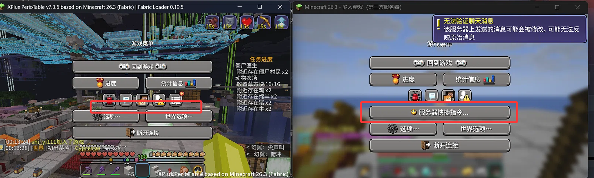

# JEI Tag Fix（非官方）

[English](README.md) | **简体中文**

阻止 **JEI** 的客户端配方回退机制抹掉服务器下发给你的 tag。

如果服务器没有把配方同步给 JEI，JEI 会在本地重建配方列表 —— 而在重建过程中，它会把
**每一个注册表里的每一个 tag** 都重新绑定成「只有原版」。服务器通过数据包提供的东西
就这样静默地从客户端消失了：

- 服务端下发的对话按钮从暂停菜单里消失
  （`minecraft:pause_screen_additions` 就是其中之一）
- 自定义的物品 / 方块 / 任何其它 tag 失效
- **不会有任何 ERROR 级别的日志**，这也是它这么难查的原因

这个 mod 让 JEI 的回退过程变成**非破坏性**的：JEI 照样拿到它的配方，你的 tag 保持不变。

**下载：** [jeitagfix-1.0.0.jar](https://github.com/GardeniaBlow/jeitagfix/releases/latest/download/jeitagfix-1.0.0.jar) —— 放进 `mods/` 即可。纯客户端 mod。

---

## 我为什么写这个 mod

这本来是玩家的问题，不是 mod 开发的问题。

我在一个服务器上玩，那个服配了数据包，会在 `minecraft:pause_screen_additions` 里注册一个
对话（dialog），于是暂停菜单里会出现一个「服务器快捷指令」按钮，里面的操作还绑了快捷键。
用原版客户端进服，一切按服务器设定的那样正常工作。

后来我换了整合包，按钮就没了 —— 同样的服务器、同样的游戏版本、同一个账号。服务器显然还在
正常下发数据（别的玩家看得见那个按钮，而且同一个对话用游戏里的物品右键也依然能弹出来），
所以问题必然在客户端。我花了很长时间去关各种 UI mod、资源包、渲染 mod —— 全都没用，而且
日志里从来没有报过错。

真正找到原因，是从「不再猜」开始：写了一个小探针 mod，进服后立刻把 dialog 注册表和 tag 状态
打印出来。结果是——对话**就在**注册表里，但指向它的那个 tag 是空的。而在不装 JEI 时物品
tag 数量是 238、装了之后是 236，这个差值一下就暴露了问题的形状；再用二分法筛 mod 列表，
几轮就锁定到了 JEI。

所以这个 mod 的目标很窄也很具体：**让 JEI 正常工作，同时不要顺手删掉服务器发过来的东西。**
如果你是因为「某个按钮只在装了某个 mod 时才消失」找到这个页面的，那你遇到的正是我当初的处境。

---

## 症状

你在一个不会向 JEI 同步配方的服务器上。`logs/latest.log` 里会出现：

```
[Render thread/INFO]: Loaded 2042 vanilla recipes from the client recipe registry.
[Render thread/INFO]: [CHAT] This Leaf server does not provide recipes to JEI.
                              JEI is showing default recipes from your client, ...
```

然后某个依赖服务端数据包 tag 的功能在客户端上不见了，而其他玩家（或者同一个客户端不装 JEI 时）
却能正常看到。

暂停菜单这个案例就是引出本 mod 的那个：服务端数据包添加了一个 `minecraft:dialog`，并在
`minecraft:pause_screen_additions` 里引用它。原版会在暂停菜单里为它显示一个按钮。
装了 JEI 之后，按钮就没了。



左边是整合包，右边是同一位玩家用原版客户端连同一台服务器。红框里那个按钮是服务端要求显示的，
在左边就是没有。没有任何报错，没有任何日志，也没有任何东西可以 grep —— 这正是值得放一张截图的原因。

## 为什么会这样

`mezz.jei.common.recipes.VanillaClientRecipeLoader#loadVanillaRecipeRegistry` 构造了一个
一次性的、**只含原版**的资源管理器，并用它重新计算 tag：

```java
MultiPackResourceManager rm = new MultiPackResourceManager(
        PackType.SERVER_DATA,
        List.of(ServerPacksSource.createVanillaPackSource().fullResources()));
...
List<Registry.PendingTags<?>> basePendingTags  = TagLoader.loadTagsForExistingRegistries(rm, frozen);
...
List<Registry.PendingTags<?>> worldPendingTags = TagLoader.loadTagsForExistingRegistries(rm, worldFrozen);
...
basePendingTags.forEach(Registry.PendingTags::apply);   // <-- 抹掉服务器 tag
worldPendingTags.forEach(Registry.PendingTags::apply);  // <-- 抹掉服务器 tag
```

`MappedRegistry$3#apply` 做两件事：把每个 pending 的 `HolderSet.Named` 绑定好，然后
**把 `MappedRegistry.allTags` 整个替换掉**，换成它拿到的那个集合。由于那个集合只由原版包
计算而来，服务器下发的 tag 就一起没了。

请注意：这只发生在**回退分支**上。如果服务器同步了配方，`loadVanillaRecipeRegistry`
根本不会被进入，也就不会重绑任何东西 —— 详见下面的《触发条件》。

在测试服上实测的前后对比（`minecraft:item` 注册表的 tag 数量）：

| | `minecraft:item` 里的 tag 数 | `minecraft:pause_screen_additions` |
|---|---|---|
| 不装 JEI | 238 | 1 条 |
| 装 JEI | 236 | 0 条 |

少的这两个，正好就是服务器数据包提供的那两个。

## Minecraft 26.2 不受影响 —— 这是 26.3 独有的回归

同一台服务器、同一句 JEI 回退日志，左边是 26.2 客户端，右边是 26.3 客户端。
26.2 上暂停菜单按钮和 `quick_actions` 快捷键都正常。

```
# 26.2 客户端，logs/latest.log
[11:02:27] Connecting to mckkk.com, 25565
[11:02:33] Loaded 1585 vanilla recipes from client resources.
[11:02:34] [CHAT] This Leaf server does not provide recipes to JEI. ...

# 26.3 客户端，logs/latest.log
[01:31:12] Loaded 2042 vanilla recipes from the client recipe registry.
[01:31:12] [CHAT] This Leaf server does not provide recipes to JEI. ...
```

两个回退都执行了。但只有其中一个摧毁了 tag。两个 JEI 分支里，同一个类含有
**完全不同的实现**：

| | 26.2 分支（`30.x`） | 26.3 分支（`31.x`） |
|---|---|---|
| 方法 | 只有 `getVanillaRecipes` | `getVanillaRecipes` + `loadVanillaRecipeRegistry` |
| 配方怎么读 | `SimpleJsonResourceReloadListener.scanDirectory(rm, RECIPE_LISTER, ops, Recipe.CODEC, map)` | `RegistryDataLoader.load(...)` 重新读取注册表 |
| `PendingTags::apply` | **没有** | 两处调用 |
| 对活动注册表的影响 | 无 —— pending tags 只用于构造临时的 `RegistryOps` | `allTags` 被整体替换 |
| 日志文本 | `Loaded {} vanilla recipes from client resources.` | `... from the client recipe registry.` |

26.2 的实现正是 mezz 最初的回退方案
（[`274fd56a`](https://github.com/mezz/JustEnoughItems/commit/274fd56a841d3d4d3fea703eb4b93e4eb4554437)，
2026 年 7 月），而且 26.2 分支的最新构建（`30.48.0.244`，2026 年 10 月核对）里依然如此：
`javap -c` 完全找不到 `apply` 调用。

26.3 上发生了什么：移植到新的数据包注册表加载路径
（[`077f5c55`](https://github.com/mezz/JustEnoughItems/commit/077f5c55b9b377ae24f6fe5645967fc19a2ae26c)）
之后，必须用 `RegistryDataLoader` 重建配方、而不能靠扫 JSON；为了让重建出来的数据「生效」，
才加上了那两个 `apply()` 调用 —— 但它们作用在**活动的**注册表上，而不是一次性的副本上。

所以，「26.2 好、26.3 坏」是预期之内的，不是整合包坏了。

## 为什么「直接跳过 `apply()` 调用」不行

这是最先尝试的做法，结果反而更糟：

```
java.lang.IllegalStateException: Trying to access unbound tag
    'TagKey[minecraft:item / minecraft:clonable_maps]'
    at net.minecraft.core.HolderSet$Named.contents(HolderSet.java:161)
    ...
[Render thread/WARN]: Client disconnected with reason: Network Protocol Error
```

`prepareTagReload` 也会为「原版包里有、但活动注册表里还没有」的 tag 创建
`HolderSet.Named` 对象 —— 而**只有 `apply()` 会绑定它们**。跳过 `apply()`，这些集合就会
永远处于未绑定状态；下一个遍历到涉及这类 tag 的配方时就会崩溃，客户端被踢下线。

## 这个 mod 做了什么

在 `loadVanillaRecipeRegistry` 的头部和返回处各注入一次：

1. **HEAD** —— 对所有注册表快照当前的 tag 状态（`tag -> List<Holder>`），
   从每个**已绑定**的 `HolderSet.Named` 中拷贝 holder。
2. **RETURN** —— 读回 JEI 装进去的那一份，把快照覆盖上去（服务器状态优先），
   然后通过同一套公开 API 把合并结果写回：
   `registry.prepareTagReload(new TagLoader.LoadResult<>(key, merged)).apply()`。

这样每个 `HolderSet.Named` 最终都是已绑定的，不会有悬空集合。JEI 的 `RecipeMap` 是从
另一个**独立的** frozen `RegistryAccess` 构建的，不受影响 —— 配方搜索和原来完全一致。

成功时 `logs/latest.log` 里会看到：

```
[Render thread/INFO]: [jeitagfix] restored tags for 127 registries (2 server tag(s) re-added), 0 failed
```

## 兼容性

- Minecraft **26.3**、Fabric Loader **0.19.5+**。本 mod 声明 `minecraft: ~26.3`，在 26.2 上
  不会加载 —— **26.2 也不需要它**（见上面的分支对比）。
- JEI **31.7 至 31.17** 全部受影响 —— 破坏性代码不是新加的，所以
  **升级 JEI 并不能修复这个问题**。已针对 31.3.0.17、31.4.0.19、31.7.0.38、31.16.0.83、
  31.17.0.109 逐一验证。
- 纯客户端。装在客户端连任何服务器都是安全的；在**会同步配方**的服务器上，回退根本不会执行，
  本 mod 也就什么都不做。

## 触发条件（以及什么时候不会触发）

以下三条必须同时成立：

1. **26.3** + `31.x` 分支的 JEI（实测 31.3 至 31.17）。
2. JEI 启动时**拿不到**非空的配方集 —— 也就是进入了 `JeiStarter#start` 的回退分支。
   原版自己的 `ClientboundUpdateRecipesPacket` 只携带 `itemSets` 和 `stonecutterRecipes`，
   从来不包含配方表本身，所以单纯的 Paper / Leaf / 原版服务器必然落进这个分支。
   （Fabric 服务器可以通过 `fabric-recipe-api-v1` 推送真实配方 —— JEI 会把
   `jei:jei_shaped` / `jei:jei_smelting` 注册为可同步的 serializer，
   但前提是**服务端**也装了 JEI。）
3. 服务器确实通过数据包下发了 tag（例如 `minecraft:pause_screen_additions` 里引用的
   一个 `minecraft:dialog`）。

如果服务器确实同步了配方，`loadVanillaRecipeRegistry` 根本不会被调用，tag 完全不受影响 ——
这一点已用同一台服务器、同一个客户端、只改变服务端有没有装 JEI 做了 A/B 实测：

| | 服务端装了 JEI（同步生效） | 服务端没装 JEI（走回退） |
|---|---|---|
| `Internal.hasClientSyncedRecipes` | **true** | false |
| `Internal.hasClientFallbackRecipes` | false | **true** |
| `minecraft:pause_screen_additions` | **1 条** | 0 条 |
| `minecraft:item` 里的 tag 数 | **508** | 236 |
| 暂停菜单按钮 | **有** | 无 |

那个 508 → 236 的落差，就是「只用原版重算」的结果，也是这个问题唯一可见的痕迹。

## 服务器端能修吗？

能修一部分，但**没有任何设置、指令或配置项可以直接打开它**。

**不存在这样的配置。** Minecraft 自己的协议从不下发配方表：`ClientboundUpdateRecipesPacket`
只有 `itemSets` 和 `stonecutterRecipes` 两个字段（26.2 和 26.3 都是如此）。`server.properties`、
`spigot.yml`、`paper-global.yml`、`purpur.yml` 里也没有任何跟配方同步或 tag 同步相关的项。
所以在原版、Paper、Leaf、Purpur 上，"服务器端把配方同步打开"这件事本身就不存在。

**但服务器可以通过重发 tag 包来修。** JEI 破坏的是活动 `Registry` 的 tag 集合；再发一次
`ClientboundUpdateTagsPacket`，就能用服务器上的真实数据把它重建回来。在一台 Fabric 26.3
测试服 + 干净客户端（Fabric API + JEI 31.16.0.83，**不装 jeitagfix**）上实测，数据包提供
`pause_screen_additions`：

| 时刻 | `pause_screen_additions` | `minecraft:item` 里的 tag 数 | 按钮 |
|---|---|---|---|
| tick 80，刚进服 | 0 | 236 | 无 |
| tick 800，40 秒后 | 0 | 236 | 无 |
| 执行 `/reload` 后 | 0 | 236 | 无 |
| 单独重发一次 tag 包后 | **1** | **507** | **有** |
| 之后 60 秒 | 1 | 507 | 仍有 |

`/reload` **确实**会重发 tag —— `PlayerList#reloadResources` 会无条件发送
`ClientboundUpdateTagsPacket` —— 但同一次 reload 还会让客户端重载资源包，导致 JEI 重启，
于是回退再跑一遍，把 tag 又抹一次。两个效果互相抵消。而单独发一个 tag 包不会触发资源重载，
所以恢复回来的东西就留住了。

现实中：

| 服务器类型 | 能修吗 | 怎么做 |
|---|---|---|
| Fabric，服务端装了 JEI | 能，最干净 | 客户端能拿到真配方，回退根本不会跑 |
| Fabric，服务端没装 JEI | 能 | 一个小 mod 或指令，重新广播 `ClientboundUpdateTagsPacket` |
| Paper / Leaf / Purpur | 只能靠插件 | 需要 ProtocolLib 或 PacketEvents 手动发这个包 |
| 原版 | 不能 | 没有插件 API，没有办法发这个包 |

对于在别人服务器上玩的玩家（也就是绝大多数情况），这些都用不上，客户端侧的修复是唯一选项。

## 已知限制

- mixin 是按名字定位 `mezz.jei.common.recipes.VanillaClientRecipeLoader#loadVanillaRecipeRegistry`
  的。如果 JEI 改名或重构了这个方法，本 mod 会**大声失败**（两处注入都是 `require = 1`，
  `defaultRequire` 也是 1），而不是静默失效 —— 你会看到 mixin 应用错误，而不是又一个谜团。
- 被合并回来的 tag 是 `HEAD` 那一刻存在的那些。数据包在那之后（即游戏中途）新增的 tag
  不在覆盖范围内。
- 如果快照阶段本身抛异常，本 mod 会打一条警告然后让路，保持 JEI 的原生行为。

## 安装

把 `jeitagfix-<version>.jar` 放进 `.minecraft/mods/` 即可。就这么多 —— 没有配置文件，
除了 JEI 本身没有其它依赖。

## 构建

标准的 Fabric Loom 工程。Gradle wrapper 没有提交进仓库，所以先自己生成一次
（`gradle wrapper`，或者让 IDE 做）：

```bash
./gradlew build        # jar 生成在 build/libs/
```

在没有网络的环境下，`build-offline.ps1` 仅凭一个 JDK 25 和启动器 `libraries/` 目录里已有的
jar 就能复现同样的产物（发布用的那个 6738 字节的 artifact 就是这么产出的，使用
`--release 21`）。

## 这不是 JEI 独有的问题

同类破坏也会出现在别的配方查看器上。最清楚的例子是
[shedaniel/RoughlyEnoughItems#2059](https://github.com/shedaniel/RoughlyEnoughItems/issues/2059)
（`[Bug] Disables functionality of vanilla "pause_screen_additions"`，2026-06-27 提出，
至今仍处于 open 状态）：只装 REI 加上 Fabric API / Architectury / Cloth Config 时，
服务器下发的 `pause_screen_additions` 数据就不会生效 —— 只有在 `/reload` 之后才出现。

如果你自己在排查这个问题，有几点值得知道：

- **几乎没有人向 JEI 报告过这个问题** —— 在本 mod 编写时，JEI 的 issue 区里
  `pause_screen_additions` 零命中。
- 在 GitHub 全站搜索 `pause_screen_additions`，只会找到协议实现和服务端插件文档，
  从来不是玩家报告。这个症状很容易被误归因到服务器、整合包或资源包上。

## 反馈

如果你能在不依赖本 mod 的情况下独立复现 JEI 的底层行为，也请向上游报告 ——
那边真正修好，比客户端绕过更好。需要附带什么内容见 [Issues](../../issues)
（日志片段、丢失的是哪个 tag、`does not provide recipes` 那行是否出现）。

向 JEI 报告时一个有用的细节：那两处 `PendingTags::apply` 调用**并不是**最初那个回退功能的
一部分
（[`274fd56a`](https://github.com/mezz/JustEnoughItems/commit/274fd56a841d3d4d3fea703eb4b93e4eb4554437)，
issue [#4349](https://github.com/mezz/JustEnoughItems/issues/4349)，当时只构造了一个临时的
序列化上下文，完全没有动活动注册表）。它们是后来由 26.3 的移植提交
（[`077f5c55`](https://github.com/mezz/JustEnoughItems/commit/077f5c55b9b377ae24f6fe5645967fc19a2ae26c)，
*Port Fabric build to 26.3 snapshot 7*）引入的。

## 开发说明

本仓库的代码是在人类主导下、由 AI 编程助手协助编写的。问题是通过实验定位的 ——
先由一个运行时探针 mod 输出注册表与 tag 状态，再在受控测试服上对 mod 列表做二分，
最终缩小到具体的 mod。最终方案是在一个更简单的做法实测失败之后才形成的
（见上文《为什么「直接跳过 `apply()` 调用」不行》）。本文档中的所有结论都在真实的
客户端/服务端组合上验证过；由仓库所有者维护与测试。

## 许可证

[MIT](LICENSE)。
